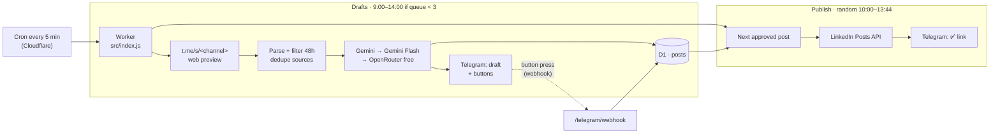

# LinkedIn AI Autoposter

> A project for automatically publishing posts to my LinkedIn profile. All the code is vibecoded (Claude Code), with my technical review and approval =) In the end it turned into a tool I use every day, and I might keep updating it in the future.

**What it is:** a bot that reads media buying and affiliate marketing news from Telegram channels, writes a post in my voice in three languages, sends the draft to my Telegram for one-tap approval, and publishes it to LinkedIn at a random time every day.

**100% free stack** · runs 24/7 on Cloudflare Workers · no server, no credit card

---

## What it does

- 📰 **Collects news** from public Telegram channels about media buying and affiliate marketing (last 48 hours, already-used sources are skipped).
- ✍️ **Writes a post** in the author's voice: few-shot prompt with real examples of my texts, two formats (personal experience / opinion), emoji and hashtag rules, a blacklist of "AI-sounding" phrases.
- 🌍 **One topic → three posts**: Ukrainian, Russian and English versions, published on three consecutive days.
- ✅ **Human in the loop**: every draft arrives in Telegram with *Publish / Another topic / Skip* buttons. Nothing goes out without approval.
- 🕐 **Human-like timing**: one post a day at a random time between 10:00 and 13:44 (Kyiv). The time is stable for the day and catches up if a run was missed.
- 🔁 **AI fallback chain**: Gemini 4 Hydrogen → Gemini 3.8 Flash → free models on OpenRouter, with a retry on overload.
- 🔔 **Notifications**: publication links, errors (rate-limited), and a reminder 7 days before the LinkedIn token expires.
- 🤖 **Bot commands**: `/status`, `/generate`, `/publish_now`.

## Architecture



### Post lifecycle

| Status | Meaning |
|---|---|
| `draft` | Generated, waiting for approval in Telegram |
| `approved` | Approved, waiting in the publishing queue |
| `published` | Posted to LinkedIn |
| `skipped` | Rejected or replaced with another topic |

## Tech stack

**Production version — Cloudflare Workers** (`worker/`)

| Area | Technology |
|---|---|
| Runtime | Cloudflare Workers (free plan), JavaScript ES modules |
| Scheduling | Cloudflare Cron Triggers (one `*/5 * * * *` trigger, time logic in code by `Europe/Kyiv`) |
| Database | Cloudflare D1 (SQLite): `posts` queue + `settings` key-value |
| Tooling | Wrangler CLI, Node.js built-in test runner (`node --test`) |
| AI | Google Gemini API (`gemini-4-hydrogen`, `gemini-3.8-flash`, JSON response mode), OpenRouter (`google/gemma-4-31b-it:free`, `openrouter/free` router) |
| Telegram | Bot API: webhook with secret token, inline keyboards, callback queries, bot commands |
| LinkedIn | OAuth 2.0 + OpenID Connect (`openid profile w_member_social`), Posts API (`/rest/posts`), automatic `LinkedIn-Version` fallback, "little text" escaping and hashtag templates |
| Sources | Public Telegram channel web previews (`t.me/s/<channel>`) parsed without third-party services |

**Previous version — n8n** (`n8n/`, currently paused, see below)

| Area | Technology |
|---|---|
| Automation | n8n Community Edition (self-hosted, Docker) |
| Storage | n8n Data Tables |
| Nodes | Schedule / Manual / Execute Workflow triggers, Code (JS), HTTP Request, LangChain Basic LLM Chain with Gemini + OpenRouter fallback model, LinkedIn, Telegram, Wait |
| Infra | Docker Desktop, Docker Compose, Caddy (auto HTTPS), DuckDNS |

**Development**: Claude (claude.ai) and Claude Code for AI pair programming, VS Code, PowerShell, Git.

## Engineering notes

| Problem | Solution |
|---|---|
| Keep it free and running while my PC is off | Moved from local n8n to Cloudflare Workers + D1 (no card needed) |
| Free plan: 10 ms CPU per cron run | All heavy lifting is network I/O (not counted); parsing is lightweight regex; one cron for everything |
| Telegram channels have no reading API | Parse the public web preview `https://t.me/s/<channel>` |
| LinkedIn truncates posts with `( ) @ _ #` | Escape reserved characters and convert hashtags to `{hashtag\|\#\|Tag}` |
| LinkedIn API versions expire monthly | Try `LinkedIn-Version` from the current month backwards, remember the one that works |
| Free AI models get overloaded (503/429) | Retry once, then a chain of Gemini models, then OpenRouter's free-model router |
| AI text sounds like AI | Few-shot prompt with real texts, strict structure, emoji placement rules, banned phrases, random format choice |
| Posting at the same time looks automated | Daily random target time (hash of the date) within a 10:00–13:44 window, with in-run wait and catch-up |
| Expiring LinkedIn token (60 days, no refresh) | Stored expiry, Telegram reminder 7 days ahead, one-link reconnect via `/linkedin/connect` |

## Repository structure

```
.
├── worker/                    # ✅ production: Cloudflare Worker
│   ├── src/index.js           # cron, Telegram webhook, LinkedIn OAuth + publishing, AI chain
│   ├── src/lib.js             # pure functions: time, parsing, scheduling, escaping
│   ├── src/prompt.js          # system prompt (generated from prompts/)
│   ├── test/lib.test.js       # unit tests
│   ├── schema.sql             # D1 tables
│   ├── wrangler.toml          # config (secrets are NOT stored here)
│   └── DEPLOY.md              # step-by-step deploy guide (RU)
├── n8n/                       # ⏸ previous n8n version (paused)
│   ├── workflows/             # WF2 drafts, WF3 buttons, WF4 publisher
│   ├── deploy/                # docker-compose + Caddy for a VPS
│   ├── docs/setup.md
│   └── scripts/sanitize-workflow.js
└── prompts/
    └── system-prompt.md       # author voice prompt
```

## Quick start (Cloudflare)

```bash
cd worker
npx wrangler login
npx wrangler d1 create autoposter            # put database_id into wrangler.toml
npx wrangler d1 execute autoposter --remote --file=schema.sql
npx wrangler deploy
npx wrangler secret put TELEGRAM_BOT_TOKEN   # + the other secrets from DEPLOY.md
```

Then open `<worker-url>/setup?key=<ADMIN_KEY>` (Telegram webhook) and `<worker-url>/linkedin/connect?key=<ADMIN_KEY>` (LinkedIn). Full guide: **[worker/DEPLOY.md](worker/DEPLOY.md)**.

Run tests: `cd worker && npm test`

## About the n8n version

The project started as three n8n workflows (drafts, approval buttons, publisher) running in Docker on my home PC. It is complete and was tested end to end, including real posts to LinkedIn.

It is **paused** because of my own infrastructure issues, not the workflows: the home PC can't stay on while I travel, and free cloud VMs (Oracle Cloud, Google Cloud) rejected my card during sign-up. So the same logic was rewritten as a Cloudflare Worker. The n8n workflows and a ready VPS setup are kept in `n8n/` and can be brought back on any server with Docker.

## Security

- All secrets live in Cloudflare secrets (`wrangler secret put`), never in the repo.
- The Telegram webhook checks a secret token; buttons and commands are accepted only from the owner's chat ID.
- Admin endpoints require `ADMIN_KEY`; the LinkedIn OAuth flow uses a one-time `state`.
- n8n exports go through `n8n/scripts/sanitize-workflow.js` before committing.

## Roadmap

- [ ] "My notes": forward any text to the bot → it becomes a post in my voice
- [ ] Post analytics (reactions, comments) back into D1
- [ ] Image generation for posts
- [ ] Web dashboard for the queue

---

## Українською

Автоматизація LinkedIn для медіабаєра. Бот збирає новини з Telegram-каналів про арбітраж трафіку, ШІ пише пост у моєму стилі трьома мовами (UA / RU / EN), я затверджую чернетку кнопкою в Telegram, а пост виходить щодня у випадковий час з 10:00 до 13:44. Працює 24/7 на Cloudflare Workers безкоштовно. Попередня версія на n8n готова, але зараз на паузі через проблеми з моєю інфраструктурою. Код навайбкодив за допомогою claude code =) .

## License

[MIT](LICENSE)
